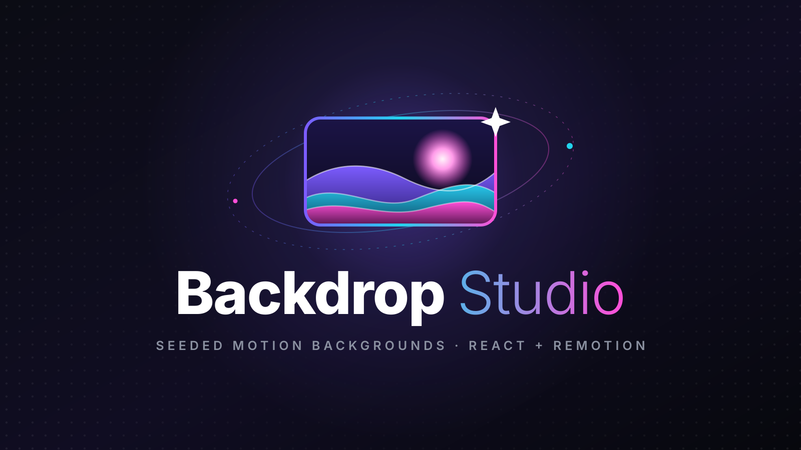

<p align="center">
  
</p>

# Backdrop Studio — React + Remotion

Seeded, procedural motion backgrounds (29 patterns + a Chaos layer-stacker) drawn with Canvas 2D,
previewed with the Remotion Player and rendered to video with the Remotion CLI. Every frame is a pure function of
(look, time), so the same JSON renders the same pixels at any resolution, in any order, on any number of cores.

## Run

```
npm install
npm run dev        # editor at http://localhost:5518
npm run studio     # Remotion Studio (browse the "Backdrop" and "ChaosExample" compositions)
npm test           # determinism snapshot tests (see below)
```

## Render

1. In the editor, design a look, pick size/FPS/duration, choose a codec under **Render with Remotion**.
2. Click **Download props** and save the JSON into this folder.
3. Run the copied command, e.g.

```
npm run render -- out/my-bg.mp4 --props=./my-bg.json --codec=h264
```

Other codecs: `--codec=h265`, `--codec=vp9`, `--codec=prores --prores-profile=4444`, `--codec=gif --every-nth-frame=2`,
or a PNG sequence with `--sequence --image-format=png`. Stills: `npm run still -- out/frame.png --props=./my-bg.json --frame=120`.

**Every aspect ratio at once** (a look is resolution independent):

```
npm run batch -- --props=./my-bg.json --aspects=16:9,9:16,1:1,4:5 --quality=1080 --codec=h264
```

The props file:

```jsonc
{
  "cfg": { ... },               // the look: the Seed JSON shown in the editor
  "width": 1920, "height": 1080, "fps": 30, "durationInSeconds": 10,
  "loop": true,                 // seamless loop (see below)
  "loopFade": 1.5,              // crossfade seconds, only used by patterns that can't loop natively
  "transparent": false,         // no background: needs ProRes 4444, VP9 or PNG output
  "audio": { "src": "track.mp3", "reactivity": 1, "volume": 1, "matchLength": true }
}
```

Examples in `examples/`: `flowfield-ocean.json`, `galaxy-loop.json`, `tunnel-audio.json` (uses `public/test-beat.wav`),
`bokeh-alpha.json` (transparent).

The editor also has a **Quick export** (WebCodecs, in-browser MP4/WebM/PNG) for when you don't want the CLI.

## Features

- **True seamless loops.** With loop on, frame *duration* is identical to frame 0. Patterns get loop helpers
  (`g.tn` noise on a circle in 4D, `g.lq` whole-cycle rates, `g.cyc` life cycles), so motion repeats exactly
  instead of crossfading. Slow motions are nudged to whole cycles, which can make them a little faster on short
  loops. Flow Field (stateful trails) falls back to a crossfade.
- **Audio reactive.** Load a track in the editor (or `"audio"` in props; files go in `public/`). Loud passages
  push time forward, bass hits zoom and flash. The analysis is precomputed for every frame, so parallel renders
  agree. Remotion renders include the soundtrack; `matchLength` sizes the clip to the track. Loop is off with audio.
- **Transparent background** for overlays: ProRes 4444 (`--image-format=png --pixel-format=yuva444p10le`),
  VP9 (`--pixel-format=yuva420p`) or PNG. Vignette and calm zone fade to transparent instead of darkening; film
  grain is skipped.
- **Pattern options.** Each pattern exposes its own sliders (tunnel sides, galaxy arms, topo levels…). Unset
  options stay "auto" (seeded). Stored in `cfg.opts` / `layer.opts`.
- **Smarter Chaos.** At most one opaque "field" pattern, always at the bottom; transparent shapes above. About 30% of
  rolls are a *reveal*: a field shown only through a shape layer (`"mask": <layer index>`), e.g. plasma through
  halftone dots. **Mutate** makes a small, reproducible variation of the current look.
- **Layout.** Calm zone (`cfg.calm`: left/right/top/bottom/center) keeps an area quiet for text. Preview-only
  guides: title/action safe, vertical social UI zones, rule of thirds.
- **Library.** Favorites and recent history (stored in this browser). The address bar always holds a share link
  (`#look=…`) with the look and output settings.

## Layout

```
src/
  engine/       rng + noise (3D/4D), ColorEngine, SeedEngine (chaos, mutate, validation), MotionEngine (renderer),
                AudioEngine (per-frame features), ExportEngine (WebCodecs)
  generators/   one file per pattern; index.ts is the registry
  presets/      themes.json
  remotion/     Backdrop composition (shared by Player and CLI), Root, entry
  ui/           React editor, library (favorites/history/share links)
scripts/        render-batch.mjs (all aspect ratios), snapshot.mjs (determinism tests)
public/         audio for CLI renders
tests/          snapshots.json
```

Add a pattern: create `src/generators/<name>.ts` exporting a `Generator` (`kind`, optional `controls`,
`make(g) => (t) => draw`), register it in `generators/index.ts`. Scale every pixel size by `g.s`, derive motion
from `t` + `g.rng`, and use `g.tn` / `g.lq` / `g.cyc` for anything time-based so it loops. Then `npm test -- --update`.

## Tests

`npm test` renders ~40 small stills through the real Remotion pipeline (every pattern, plus loop, chaos + mask,
calm zone, options and transparency), renders each again in reverse order (must match itself, which catches
hidden state), and compares hashes with `tests/snapshots.json`. After an intentional visual change, run
`npm test -- --update`. Hashes depend on the machine's rasteriser, so record them where the tests run.

## Notes

- Windows: Remotion spawns `ffmpeg.exe` and a headless Chrome from `node_modules`. If the project lives in a folder
  whose path is very long (over ~150 characters), those spawns fail with `ENOENT` because of the 260-character path
  limit. Keep the project in a short path such as `C:\dev\backdrop`.
- The single-file `backdrop-studio.html` prototype was retired in favour of this app (it is in git history).
